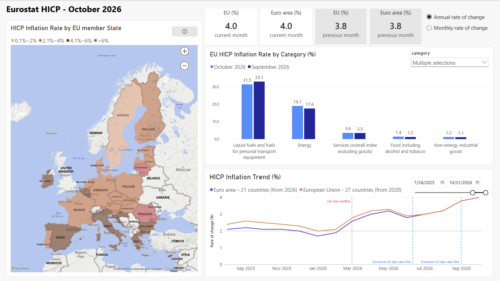

# 歐洲通膨追蹤－資料流程建置與經濟分析

[English](README.md) | [繁體中文](README.zh-TW.md)

## 專案概述

本專案整合 Python、SQL 與 Power BI，建立半自動化的歐洲通膨數據追蹤流程。

透過 Python 擷取 Eurostat API 的每月經濟數據，使用 pandas 進行資料處理，並儲存至 MySQL 資料庫，最後串接 Power BI 建立互動式儀表板，進行跨國通膨趨勢監測與經濟分析。

**資料更新期間：截至 2026 年 10 月**

**專案目標**
- 自動化每月經濟數據的擷取與處理。
- 建立結構化資料庫，管理歷史數據。
- 追蹤並比較歐洲各國通膨趨勢。
- 探討經濟指標在財務監控與企業營運分析上的應用。

## 儀表板成果

透過 Power BI 整合不同分析視角，呈現歐洲各國及不同消費類別的通膨變化。

完整圖表與經濟分析內容請參考[專案簡報](docs/presentation.pdf)。

## 資料流程

| 階段 | 使用工具 | 主要工作 |
|---|---|---|
| 資料擷取 | Python、Eurostat API | 透過參數設定，擷取不同國家、期間及商品類別的數據 |
| 資料處理 | Python、pandas | JSON 解析、資料清理、轉換與標準化 |
| 資料管理 | SQL、MySQL | 資料儲存、完整性檢查、避免重複匯入及建立分析 View |
| 資料視覺化 | Power BI | 建立互動式儀表板，進行經濟分析 |

**每月資料更新流程**

Eurostat 發布數據 → Python 擷取資料 → MySQL 更新資料 → Power BI 重新整理

## 儀表板與經濟分析

儀表板主要涵蓋四個分析面向：

- **通膨總覽：** 比較歐盟與歐元區整體通膨走勢。
- **國別比較：** 透過地圖與排行呈現各國通膨差異。
- **消費類別分析：** 比較能源、服務、工業商品及食品等項目的通膨變化。
- **能源與零售分析：** 探討原油價格、能源通膨、食品通膨與零售銷售量的變化。

### 主要分析發現

- **各國通膨差異：** 歐洲各國通膨表現存在明顯差異。
- **能源價格影響：** 液體燃料年增率曾達約 31%，與原油價格呈現大致同向變動。
- **消費與零售趨勢：** 比較荷蘭與比利時的食品通膨及零售量，觀察兩地消費趨勢差異。

## 使用工具

| 工具 | 應用 |
|---|---|
| Python / pandas | API 資料擷取與資料處理 |
| Eurostat API | 歐洲經濟數據來源 |
| SQL / MySQL | 資料庫管理與資料完整性檢查 |
| Power BI | 互動式儀表板與資料視覺化 |

## 開發進度

**已完成**
- 建立可彈性調整國家與資料期間的擷取程式。
- 使用 Python 與 pandas 解析及標準化 Eurostat 數據。
- 將歷史資料儲存至 MySQL，並透過複合唯一鍵避免重複匯入。
- 建立 SQL 資料驗證查詢及分析專用 View。
- 完成 MySQL 與 Power BI 串接及互動式儀表板。
- 完成經濟分析與專案簡報。

**未來延伸**
- 納入更多歐洲經濟指標，如 PPI、就業率、薪資成長及家庭儲蓄率。
- 整合美國 CPI 與 EUR/USD 匯率數據。
- 持續優化每月資料更新流程，擴展跨市場分析。

## 資料來源

- [Eurostat – 調和消費者物價指數（HICP）](https://ec.europa.eu/eurostat/databrowser/product/page/PRC_HICP_MINR)
- [Eurostat – 零售貿易統計](https://ec.europa.eu/eurostat)
- 經濟部能源署－原油價格資料

---

**專案重點：** 資料流程建置｜經濟分析｜財務與企業營運決策支援

**資料更新期間：** 截至 2026 年 10 月

**專案狀態：** 已完成
